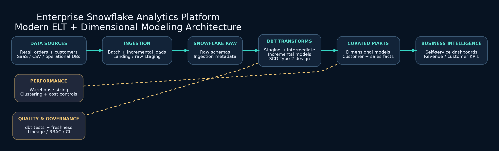

# Enterprise Snowflake Analytics Platform

### Snowflake | dbt | Apache Airflow | SQL | Data Warehousing

## Project Architecture

## Project Overview

An enterprise-style data engineering platform designed to ingest, transform, and model retail business data using Snowflake, dbt, and Apache Airflow.

The project focuses on scalable ELT pipelines, data quality, dimensional modeling, and analytics-ready data warehouses.

## Technology Stack

- **Programming:** Python, SQL
- **Data Warehouse:** Snowflake
- **Transformation:** dbt
- **Orchestration:** Apache Airflow
- **Data Modeling:** Star Schema, Fact and Dimension Tables
- **Analytics:** Power BI

## Key Features

- Retail data ingestion and transformation
- SQL-based data cleaning and validation
- Staging and analytical data models
- Customer and product dimensions
- Sales and revenue fact tables
- Incremental data processing
- Data quality testing
- Workflow orchestration

## Data Pipeline

Retail Data Sources → Apache Airflow → Snowflake → dbt → Analytics Data Marts → Power BI

## Project Status

**In Development**

Local SQL transformations are implemented. Snowflake, dbt, and Airflow integrations are planned.

## Future Enhancements

- Snowflake cloud deployment
- dbt incremental models and automated tests
- SCD Type 2 historical tracking
- Airflow DAG orchestration
- CI/CD and pipeline monitoring

## Author

**Lakshmana Rao Vallapuneni**

[LinkedIn](https://www.linkedin.com/in/lakshmanarao-vallapuneni/) | [GitHub](https://github.com/Lucky35921)
