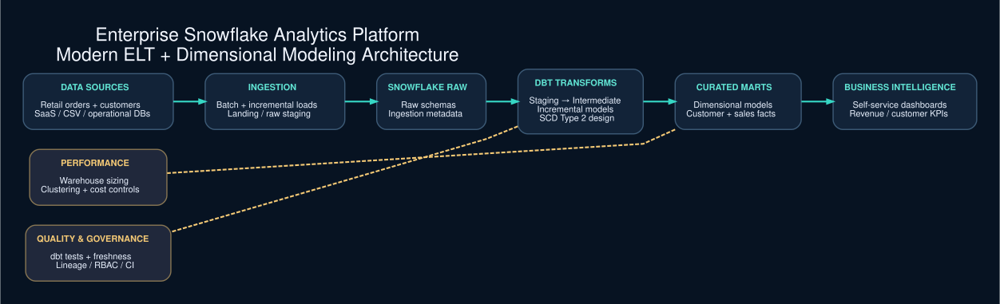

# Enterprise Snowflake Analytics Platform



> **Architecture status:** Local SQLite retail ELT demonstration implemented; Snowflake, dbt, BI and CI/CD deployment are planned. The diagram illustrates the target design, not a completed cloud deployment.


**Status: Working local SQLite ELT demonstration; Snowflake and dbt deployment are planned.**

An independent enterprise analytics engineering project using **synthetic retail orders and customers** (not NYC Taxi data). Models customer and sales marts using staging and dimensional transformations.

## Target architecture
SaaS / Files / Databases → Ingestion → Snowflake → dbt staging/intermediate/marts → BI

## Implemented locally
- Load synthetic customers and orders from CSV into SQLite staging tables.
- Build a customer dimension and daily revenue mart with SQL.
- Validate row counts, orphan orders and revenue totals.
- Standard-library unit tests.

## Run
```bash
python3 src/run_local.py --output output/retail_analytics.db
python3 -m unittest discover -s tests -v
```

## Planned milestones
1. Provision Snowflake databases, roles, warehouses and stages.
2. Configure dbt models, sources, tests and documentation.
3. Add incremental models, snapshots and SCD Type 2 dimensions.
4. Add CI quality gates, cost controls and governed BI dashboards.

The `sql/` files are SQLite-compatible local proof-of-concept SQL, not deployed Snowflake/dbt models. No production platform or performance claims.
