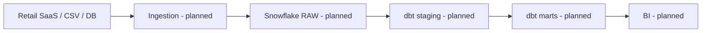

# Architecture

**Local runnable slice:** retail CSV → SQLite staging → customer dimension + daily sales mart → data quality checks.

**Production roadmap:** Snowflake RBAC, external stages, dbt tests and docs, SCD2 snapshots, incremental materializations, orchestration, observability and cost controls.
